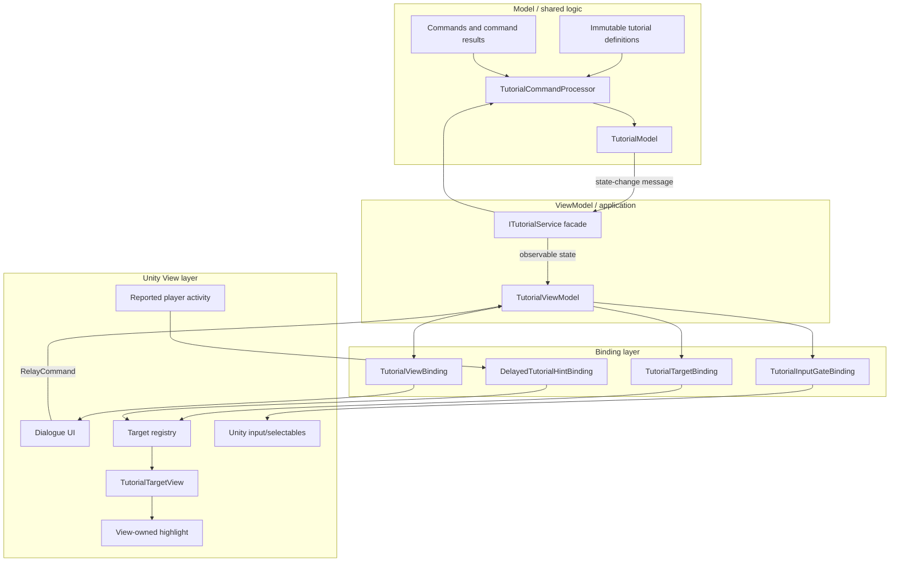
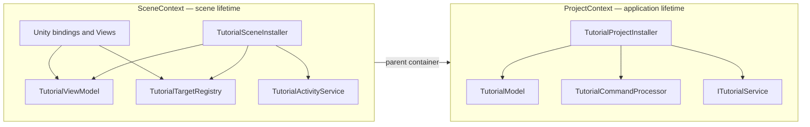
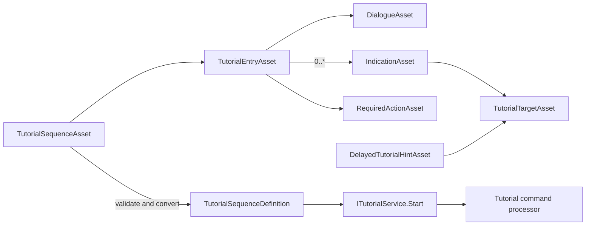
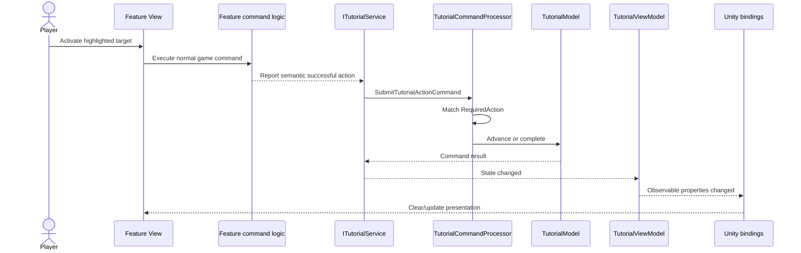
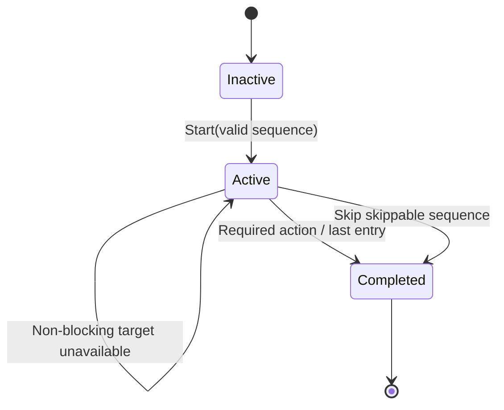
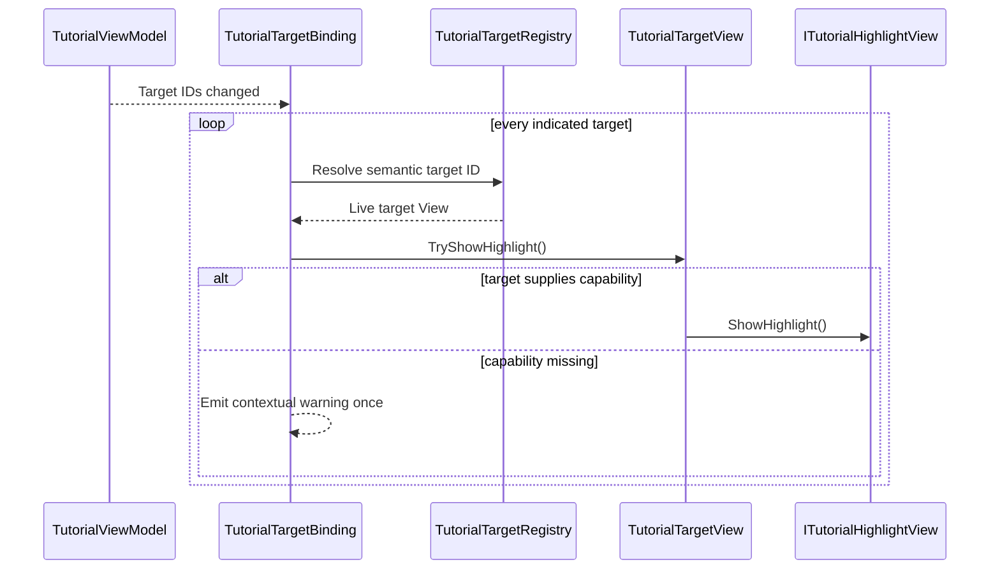
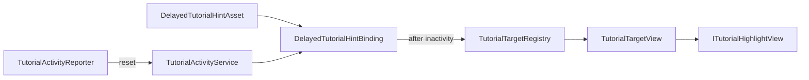

# Tutorial Architecture Proof

This Unity project demonstrates a data-authored, command-driven tutorial system built around the supplied client MVVM architecture. Tutorial progression is deterministic and testable outside Unity; Unity is responsible for authoring, dependency composition, live target resolution, presentation, and input behavior.

The project uses Unity `6000.3.10f1` and Extenject for dependency injection.

## Run the example

1. Open the Unity project in `AMTutorialArchitecture/`.
2. Open `Assets/TutorialSystem/Example/Scenes/TutorialExample.unity`.
3. Enter Play Mode.
4. Select **Start Showcase** and follow the highlighted controls through all five entries.
5. After choosing a route, remain inactive for two seconds to see the delayed **Claim Reward** hint. Any button interaction hides it and restarts its timer.

The sequence demonstrates dialogue with one selection, a two-box dialogue whose highlight appears only on the final box, a highlight without dialogue, and a blocking multi-target highlight where either route button is valid. Every target View supplies its own highlight, and normal feature behavior still executes when a tutorial target is activated.

The example can be regenerated from **Tools > Tutorial > Rebuild Example**.

## Architecture overview



Dependency direction is inward. Domain and application assemblies have `noEngineReferences` enabled and do not reference Unity or Extenject. Unity and Extenject appear only in outer assemblies.

## Extenject composition



`ITutorialService` and its implementation contain no Extenject types. Extenject constructs the object graph; it is not used as a service locator. Plain C# dependencies use constructor injection, while scene-owned `MonoBehaviour` boundaries use method injection.

## Authoring and runtime data



ScriptableObjects are immutable authoring assets. They are converted into pure C# definitions before entering the service. Player progress is never written into an asset.

Required actions do not expose a hand-authored string key. Unity-facing components reference the `RequiredActionAsset` directly, and the asset automatically stores its own Unity GUID in a hidden serialized field. Conversion uses that GUID as `ExpectedActionId` in the pure definition. This keeps authoring reference-safe while giving shared logic, persistence, and a server a deterministic plain value with no `UnityEngine` dependency. Renaming or moving an asset preserves its GUID; duplicating it creates a distinct action identity.

An entry has the following composition:

```text
TutorialEntry
├── Dialogue        optional
├── Indications     zero or more
├── InputPolicy     one policy for the indication group
└── RequiredAction  exactly one
```

Dialogue-only, indication-only, and dialogue-plus-indication entries are valid. One step can indicate multiple UI or world elements while retaining one semantic completion condition. A long dialogue is authored as multiple entries; only its final entry contains the indications. A combined entry completes through the required semantic action rather than through dialogue dismissal.

## Starting a sequence

Core code accepts the pure definition:

```csharp
TutorialStartResult Start(TutorialSequenceDefinition sequence);
```

Unity gameplay code receives `ITutorialService` through injection and can use the asset adapter:

```csharp
public sealed class SomeGameTrigger : MonoBehaviour
{
    [SerializeField] private TutorialSequenceAsset sequence;

    private ITutorialService tutorialService;

    [Inject]
    public void Construct(ITutorialService service)
    {
        tutorialService = service;
    }

    public void OnFeatureUnlocked()
    {
        tutorialService.Start(sequence);
    }
}
```

The adapter validates and converts the asset, then calls the pure service contract. Starting another sequence never silently replaces active progress; the result reports `Started`, `AlreadyActive`, `RejectedAnotherSequenceIsActive`, `AlreadyCompleted`, or `InvalidDefinition`.

## Command and progression flow



Presentation target ID and completion action ID are deliberately separate. For example, `hud.map-button` identifies what to highlight, while the referenced `OpenMapAction.asset` supplies the GUID of the successful outcome that advances the tutorial. Feature Views and emitters reference that action asset rather than repeating a string. Failed or unrelated actions do not advance the sequence.

## State machine



The current proof keeps completion state in the application-lifetime model. A production persistence adapter can serialize sequence ID, exact entry ID/index, and completion state without changing the Views or authored assets.

## Target binding and View-owned highlighting



Tutorial assets specify what receives attention, never how it looks. Each target View may implement any highlight technique, and the binding highlights every resolved target in the current entry. The showcase uses independent child visuals for buttons and contextual text; another View could use a shader, animation, VFX, pointer, or overlay cutout without modifying tutorial logic.

Target Views register and unregister stable target IDs as screens appear and disappear. A non-blocking indication group stays logically active while targets are absent and rebinds as they return. During a blocking entry, all resolved indicated `Selectable`s remain available. If none of the indicated targets is actionable, input stays unlocked and the client emits a warning instead of soft-locking the player.

## Blocking policy

The entry supplies one `Blocking` or `NonBlocking` policy for its indication group. Shared logic exposes that policy through the active state; the client decides how to implement it.

The example client implementation stores each `Selectable` state, disables unrelated controls, keeps all indicated actionable targets and the Skip control available, and restores the original states when the entry changes. This is one View implementation, not a domain rule.

## Delayed inactivity hints

Delayed hints deliberately do not become tutorial entries. They do not advance or modify `TutorialModel`; they are client presentation behavior that reuses the target registry and View-owned highlighting.



The showcase arms its reward hint after the main sequence finishes. After two seconds without reported activity it highlights **Claim Reward**. Every interactive button in the example reports activity; an actual game could connect the same service to its central input or interaction router.

## Project structure

```text
Assets/TutorialSystem/
├── Runtime/
│   ├── Domain/        pure definitions, validation, model, commands/results
│   ├── Application/   service facade, messages, RelayCommand, ViewModel
│   └── Unity/         assets, Extenject installers, bindings, target Views
├── Example/
│   ├── Authoring/MapTutorial/
│   │   ├── DelayedHints/ client-side inactivity hint assets
│   │   ├── Targets/   reusable semantic target assets
│   │   └── Steps/     one folder per authored tutorial step
│   └── Scenes/        runnable proof scene
├── Editor/            reproducible example builder
└── Tests/
    ├── EditMode/      state machine, service, ViewModel, asset conversion
    └── PlayMode/      end-to-end scene and DI integration
```

## Automated validation

Set `$UnityEditorExecutable` to the Unity `6000.3.10f1` executable available in the development or CI environment.

Compile/import validation:

```powershell
& $UnityEditorExecutable `
  -batchmode -nographics -quit `
  -projectPath 'AMTutorialArchitecture' `
  -logFile 'AMTutorialArchitecture/Logs/BatchCompile.log'
```

EditMode tests:

```powershell
& $UnityEditorExecutable `
  -batchmode -nographics -runTests -testPlatform EditMode `
  -projectPath 'AMTutorialArchitecture' `
  -testResults 'AMTutorialArchitecture/Logs/EditModeResults.xml' `
  -logFile 'AMTutorialArchitecture/Logs/EditModeTests.log'
```

PlayMode integration test:

```powershell
& $UnityEditorExecutable `
  -batchmode -nographics -runTests -testPlatform PlayMode `
  -projectPath 'AMTutorialArchitecture' `
  -testResults 'AMTutorialArchitecture/Logs/PlayModeResults.xml' `
  -logFile 'AMTutorialArchitecture/Logs/PlayModeTests.log'
```

Current automated result: seven EditMode tests and one PlayMode integration test pass.

## Deliberate extension points

The proof leaves these production integrations behind interfaces or semantic contracts:

- Save/profile-backed exact-entry restoration.
- Client/server transport and reconciliation for tutorial commands.
- Localization lookup behind dialogue text keys.
- Analytics emitted from command results.
- A production-wide activity source connected to the central input/interaction router.
- Additional required-action predicates such as counters, state predicates, `AnyOf`, and `AllOf`.
